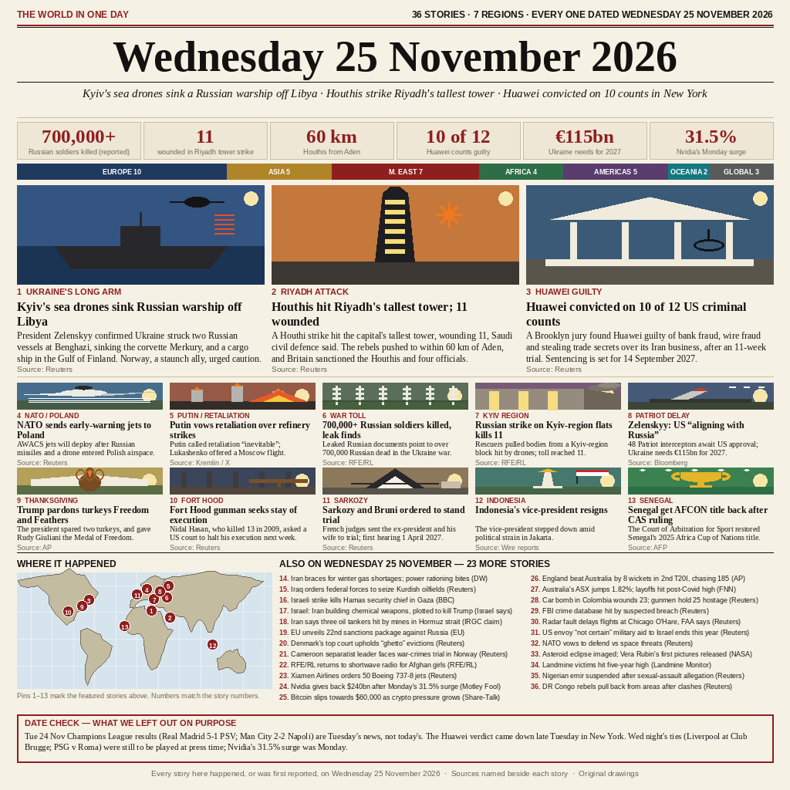

[](https://make.fun/bounty/news-image-20261125?ref=d7ry1fct)
[](https://make.fun/bounty/news-image-20261125?ref=d7ry1fct)
[](https://make.fun/bounty/news-image-20261125?ref=d7ry1fct)

# Wednesday 25 November 2026: 36 stories, 7 regions — Kyiv sinks Russian warship off Libya, Houthis strike Riyadh tower, Huawei convicted

A one-page newspaper front page that sums up the world's news of **Wednesday 25 November 2026** in a single 1024×1024 image: **36 stories across 7 regions**, every one dated that day.

## The image



- **Kicker + masthead:** "THE WORLD IN ONE DAY" over the giant date, *Wednesday 25 November 2026*.
- **Stat strip:** 700,000+ Russian soldiers killed (reported) · 11 wounded in Riyadh · 60 km Houthis from Aden · 10 of 12 Huawei counts guilty · €115bn Ukraine needs for 2027 · 31.5% Nvidia's Monday surge.
- **3 lead stories, drawn:** Kyiv's sea drones sink the Russian corvette *Merkury* off Benghazi (and a cargo ship in the Gulf of Finland); Houthis hit Riyadh's tallest tower; Huawei convicted on 10 of 12 US criminal counts in Brooklyn.
- **10 more illustrated stories:** NATO AWACS to Poland, Putin's retaliation vow, the 700,000+ war toll, the Kyiv-region strike (11 killed), the stalled Patriot interceptors, Trump's turkey pardon, the Fort Hood stay request, Sarkozy and Bruni ordered to trial, Indonesia's vice-president resigning, Senegal's AFCON title restored.
- **World map** with numbered pins for all 13 featured stories, plus **23 more stories** in the "ALSO ON…" list — Iran's winter gas crisis, Iraq's Kurdish oilfields order, the Gaza strike, the EU's 22nd sanctions package, Nvidia's $240bn give-back, England's T20I win, and more.
- **DATE CHECK box:** what was deliberately left out (Tuesday 24 Nov Champions League results, the late-Tuesday Huawei verdict timing, Wednesday night's ties still to be played, Monday's Nvidia surge).

Every story names its source (Reuters, AP, BBC, RFE/RL, Bloomberg, AFP, DW, NASA…). Claims that are one side's word are labelled as such ("Israel says", "IRGC claim").

## How it is built

`draw.py` draws `entry.png` deterministically with Pillow (flat original vector-style illustrations, Liberation fonts — no photos, no network, no wall-clock, no unseeded randomness). `main.py` (standard library only) copies `entry.png` to the output directory, so both grading runs produce byte-identical output.

Run:

```sh
python3 draw.py        # regenerates entry.png
python3 main.py        # writes entry.png to /output (or $MAKEFUN_OUTPUT_DIR)
```

## Competition

Entered in [news-image-20261125 on make.fun](https://make.fun/bounty/news-image-20261125?ref=d7ry1fct) — "Sum up 25 November's world news in one image".
